[](https://code0ne.visualstudio.com/af9bacf7-1f61-4391-8d80-986dde574894/_boards/board/t/b63c60e3-d912-476c-a04d-3bb5a272e28d/Microsoft.RequirementCategory)

# Timelyts

Timelyts (shown in the app as **Timely**) is an appointment management application built with TypeScript and React. Hosts publish bookable *session types* (one-on-one, group, collective, round robin), define weekly availability schedules, share booking links with invitees, and keep track of upcoming bookings, contacts and reminder workflows.

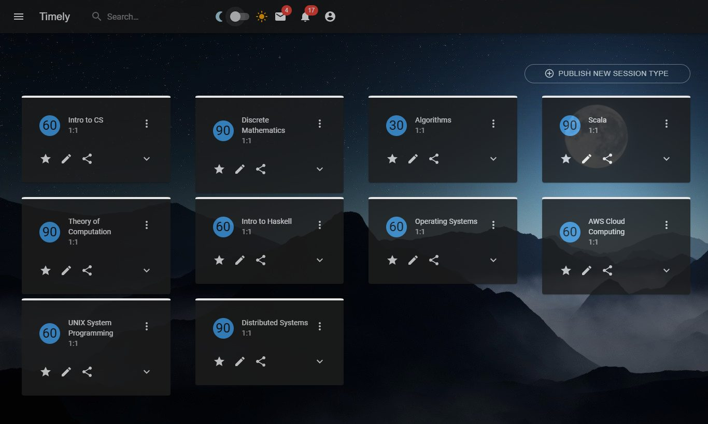

> **Project status: front-end prototype.** All screens are built and navigable, but every page renders hard-coded sample data. There is no backend API, persistence or authentication yet. See [Known limitations](#known-limitations).

## Contents

- [Features](#features)
- [Tech stack](#tech-stack)
- [Quick start](#quick-start)
- [Available scripts](#available-scripts)
- [Project structure](#project-structure)
- [Documentation](#documentation)
- [Known limitations](#known-limitations)
- [Roadmap](#roadmap)
- [Contributing](#contributing)

## Features

### Session types (Home)

The landing page (`/`) lists the host's published session types as cards showing duration (minutes), session kind and name. Each card offers favourite, edit and share actions.

### Publishing a new session type

**Publish New Session Type** opens `/publish`, where the host picks one of four session kinds:

| Kind | Description |
|---|---|
| One-on-One | Let an invitee pick a time to meet with you. |
| Group | Let multiple invitees meet with you at one time. |
| Collective | Host an event with another person and let invitees pick a time when you're all available. |
| Round Robin | Create an event that cycles between multiple hosts. |

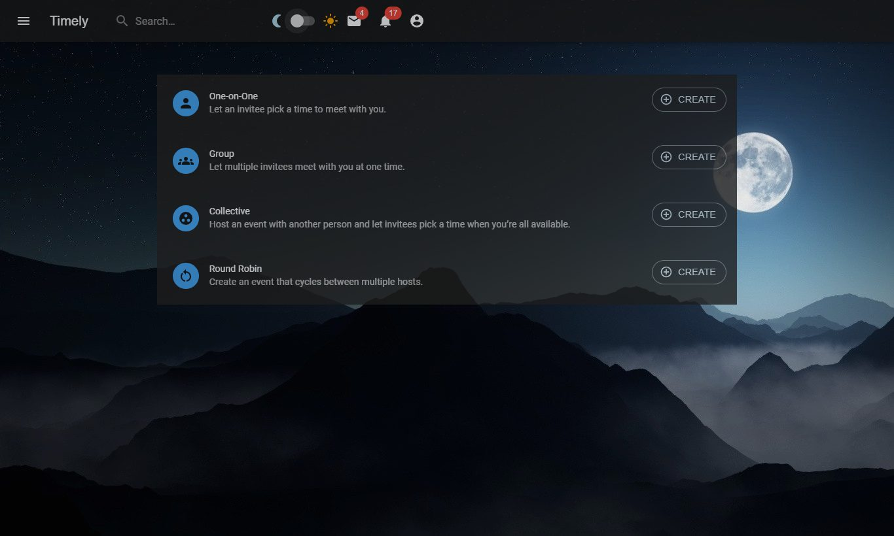

**Create** opens a short form (name, location, description, direct link, colour). **Next** continues to the full editor (`/publish/edit/:id`), which groups settings into accordion sections: Session Type, Available Times, Questions for Invitees, Workflows, Notifications and Cancellation Policy, Confirmation Page, and Collect Payments.

| Create form | Full editor |
|---|---|
| 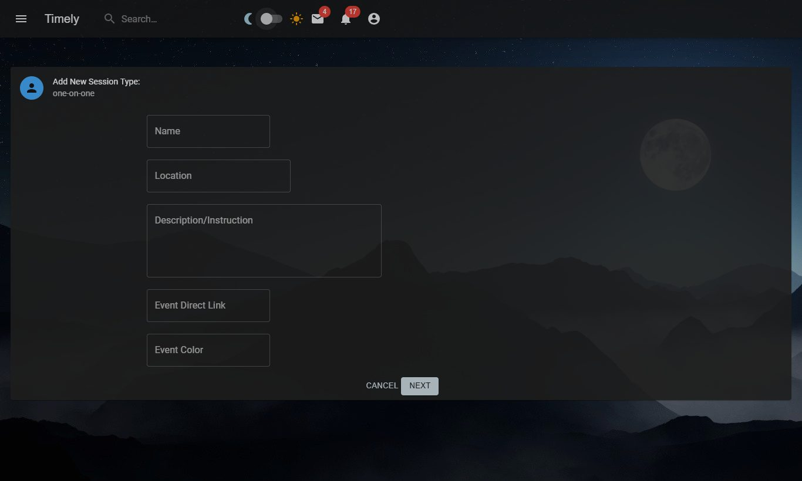 | 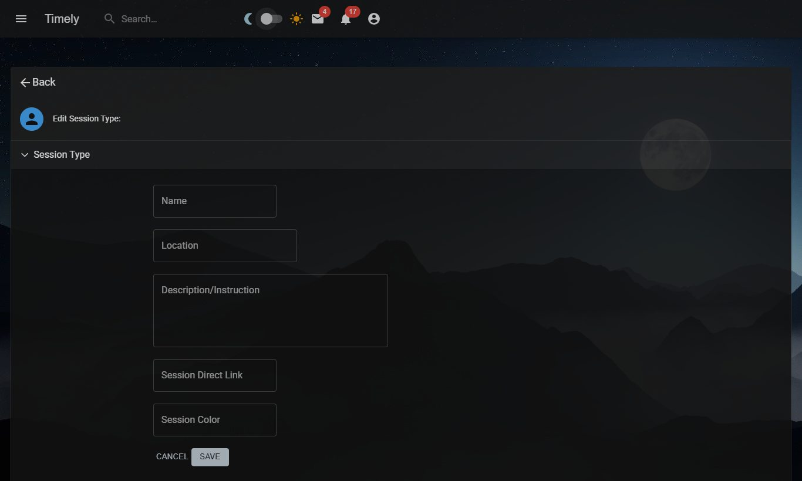 |

### Sharing a booking link

The share icon on a session type card opens a dialog with three tabs: **Share a link**, **Add to email** and **Add to website**. The link tab offers a copy button, a "Let this link expire after the first booking" option and a preview of the booking page.

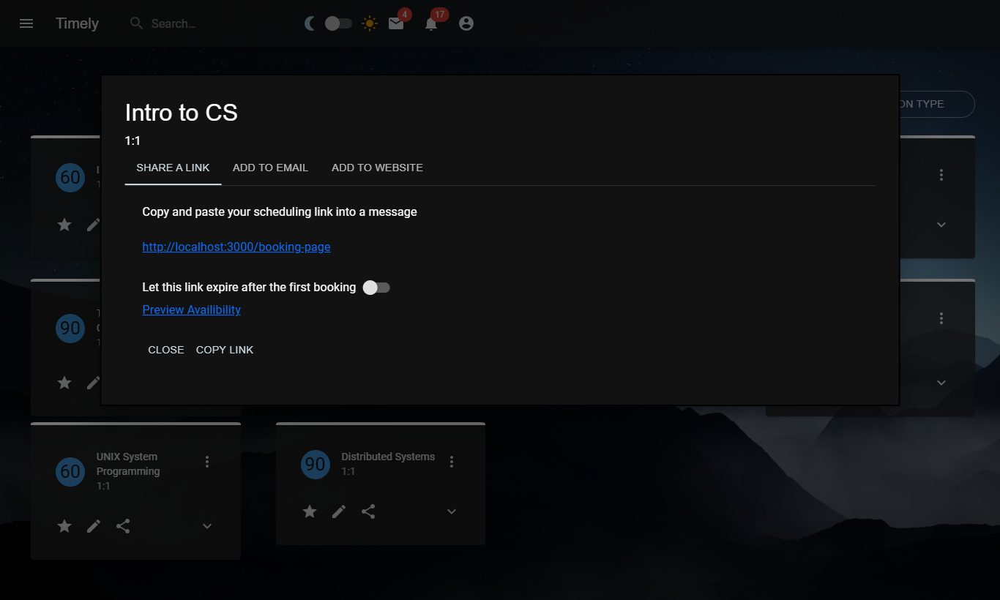

### Booking page

`/booking-page` is the invitee-facing page: session details on the left and a date picker on the right.

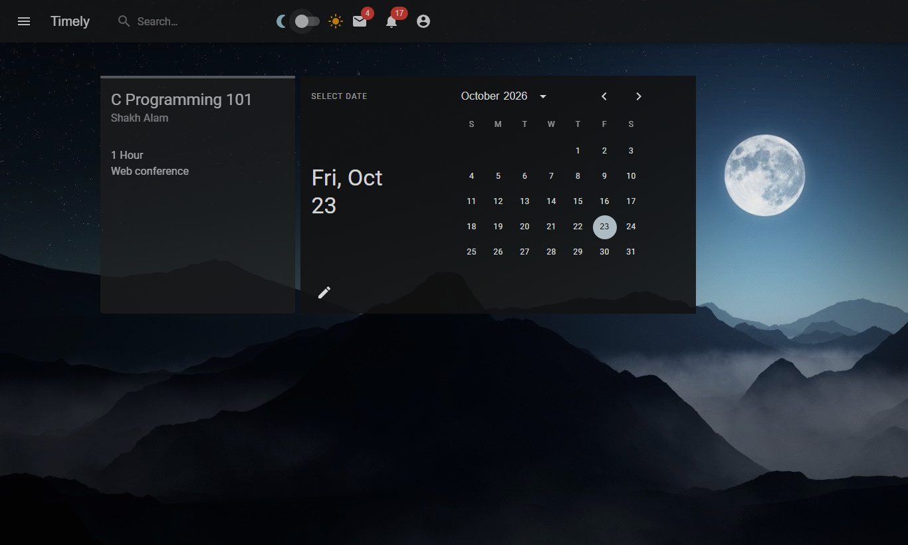

### Schedules

`/schedules` lists named availability schedules (for example "Sunday Evenings"). Expanding a schedule shows a weekly editor with a checkbox per day and start/end time pickers, plus controls to add or remove time ranges.

| Schedule list | Expanded weekly editor |
|---|---|
| 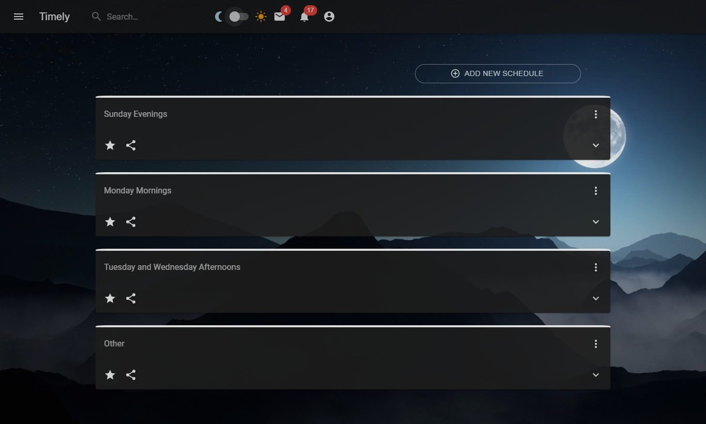 | 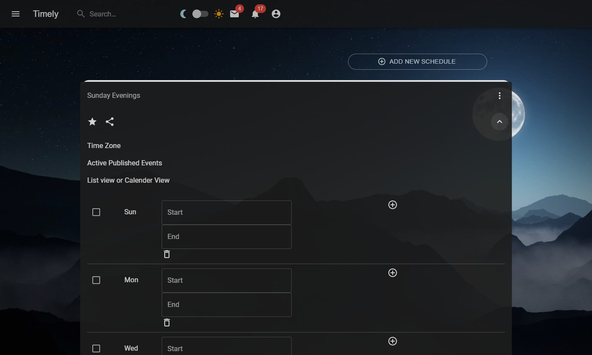 |

### Subscriptions (bookings)

`/subscriptions` shows booked sessions grouped by date, with **Upcoming**, **Pending** and **Past** tabs plus Date Range, Filter and Export actions.

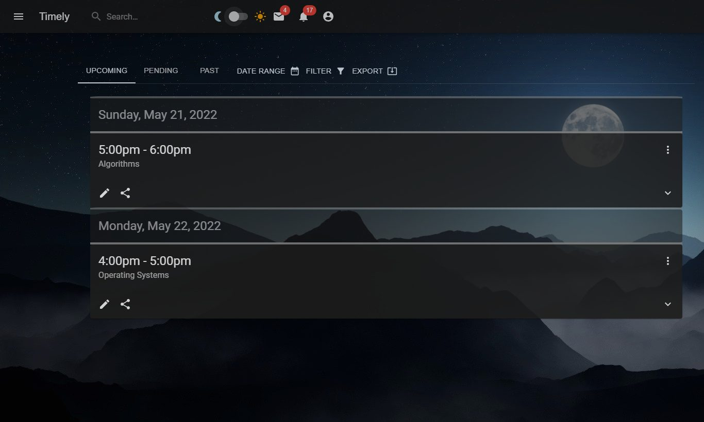

### Contacts

`/contacts` lists invitees under **Upcoming**, **Prospects** and **All Contacts** tabs.

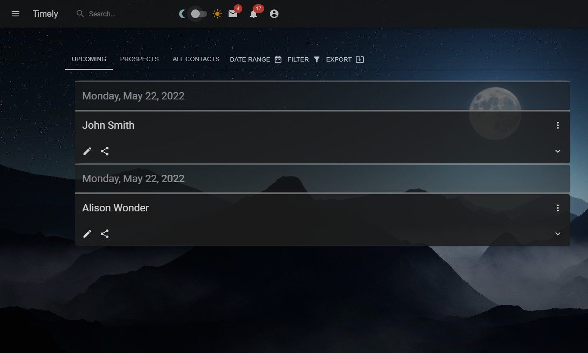

### Automations

`/automations` shows reminder workflows: email reminders to contact or host, thank-you emails and SMS reminders.

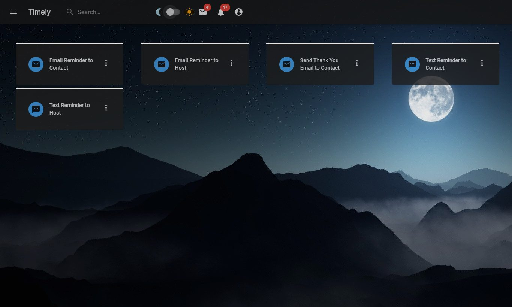

### Navigation and theming

A top app bar holds the menu button, search box, light/dark theme switch, and mail, notification and account icons. The menu opens a navigation drawer. The app starts in the light theme with a daytime background; the dark theme switches to a night sky. The other screenshots in these docs use the dark theme.

| Navigation drawer | Light theme |
|---|---|
| 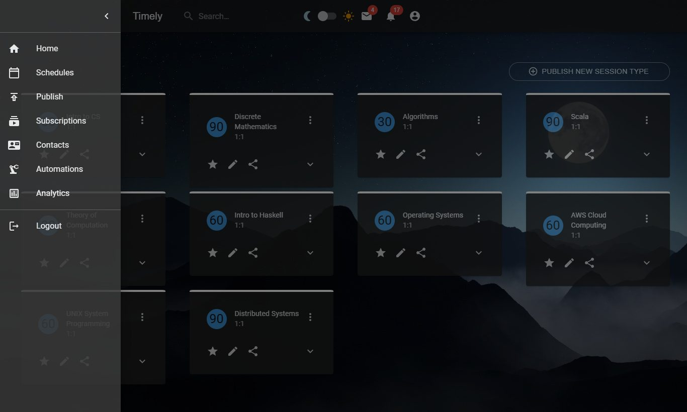 | 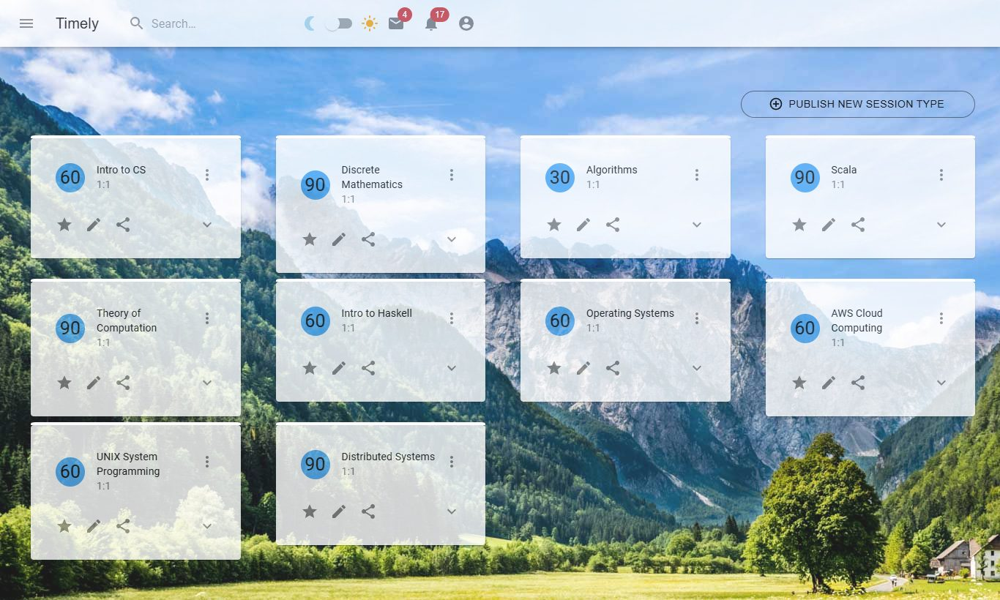 |

## Tech stack

| Area | Technology |
|---|---|
| Language | TypeScript 4.6 (strict mode) |
| UI framework | React 17 |
| Tooling | Create React App (`react-scripts` 5): webpack, Babel, ESLint, Jest |
| Components and styling | MUI 5 (`@mui/material`, `@mui/icons-material`, `@mui/lab`), Emotion, Sass, Bootstrap 5 CSS |
| Dates | `date-fns`, MUI Lab date/time pickers |
| Routing | React Router 6 |
| Production server | Express 4 (`server/server.js`) |
| Testing | Jest and React Testing Library |
| CI | Azure Pipelines (`azure-pipelines.yml`) |

## Quick start

Prerequisites: Node.js 16 or newer (CI uses 16.x; Node 22 also works) and npm.

```bash
git clone <repository-url> timelyts
cd timelyts
npm ci
npm start
```

Then open http://localhost:3000. The full walkthrough is in **[docs/getting-started.md](docs/getting-started.md)**.

## Available scripts

| Command | What it does |
|---|---|
| `npm start` | Starts the development server on http://localhost:3000 with hot reload and lint output. |
| `npm test` | Runs Jest in interactive watch mode. |
| `npm run build` | Creates an optimised production bundle in `build/`. |
| `npm run eject` | Copies the CRA build configuration into the project. **One-way; not recommended.** |
| `node server/server.js` | Starts the Express static server (port `PORT`, default 3001). See [getting-started](docs/getting-started.md#serving-the-production-build). |

## Project structure

```text
timelyts/
├── azure-pipelines.yml        # CI: install and build on every push to main
├── package.json
├── tsconfig.json
├── public/                    # index.html template, favicon, manifest
├── server/
│   └── server.js              # Express server for static hosting with SPA fallback
├── docs/                      # Getting started, architecture, screenshots
└── src/
    ├── index.tsx              # Entry point: global CSS and route table
    ├── App.tsx                # Root layout: theme, date localisation, app bar, <Outlet/>
    ├── images/                # Day and night background images
    ├── routes/                # One component per page
    │   ├── Home.tsx           #   /                session type cards
    │   ├── Calendar.tsx       #   /schedules       availability schedules
    │   ├── Subscriptions.tsx  #   /subscriptions   bookings
    │   ├── Contacts.tsx       #   /contacts
    │   ├── Automations.tsx    #   /automations     reminder workflows
    │   ├── BookingPage.tsx    #   /booking-page    invitee view
    │   ├── Profile.tsx        #   /profile         (placeholder)
    │   ├── Signin.tsx         #   /signin          (placeholder)
    │   └── publish/           #   /publish, /publish/create/:type, /publish/edit/:id
    │       └── components/    #   forms and cards used only by the publish flow
    └── components/            # Shared presentational components (cards, app bar, drawer, pickers)
```

## Documentation

- **[Getting started](docs/getting-started.md)**: prerequisites, installation, running, testing, building, deployment and troubleshooting.
- **[Architecture](docs/architecture.md)**: Mermaid diagrams of the runtime, routing, component tree, user flows, state ownership and CI.

## Known limitations

The app is a UI prototype. Before relying on it, note:

- **Mock data only.** Session types, schedules, bookings and contacts are hard-coded in the route components. Forms keep their values in local component state and never save them.
- **No authentication.** `/signin` and `/profile` are placeholders, and the drawer's **Analytics** and **Logout** links have no routes, so they show "This route is not found".
- **Fixed IDs in links.** Every edit link and the create form's **Next** button go to `/publish/edit/1`.
- **Form field names.** All inputs in the session type forms share `name="name"`, so typing in one field overwrites the same state key.
- **Theme toggle lags one click.** `handleDarkModeChange` in `App.tsx` reads the previous checkbox state and stores the theme in a module-level variable, so the theme only catches up on the following toggle.
- **Weekly editor skips Tuesday.** `ScheduleWeekView` lists Sun, Mon, Wed–Sat. On non-iOS mobile devices the time pickers don't render.
- **Express server serves `public/`, not `build/`.** `server/server.js` serves the unbuilt HTML template, so it does not serve the compiled app as written.
- **Default test is stale.** `src/App.test.tsx` still looks for CRA's "learn react" link, so `npm test` fails.
- **Unused dependencies.** `react-dnd`, `jquery` and the Bootstrap JS bundle are installed or imported but unused, and `@mui/material` and `@emotion/*` are pinned to `latest`. Use `npm ci` to install exactly what `package-lock.json` records.

## Roadmap

- Backend API and persistence for session types, schedules, bookings and contacts
- Authentication (sign in, profile, logout)
- Real booking flow: available-slot calculation from schedules, confirmation and calendar invites
- Working automations (email and SMS delivery)
- Analytics page and calendar view (`ScheduleCalendarView` is currently an empty stub)
- Test coverage for routes and components

## Contributing

1. Create a branch from `main`.
2. Run `npm start` and check your change in the browser. Run `npm test` and `npm run build`.
3. Open a pull request. Azure Pipelines builds every push to `main`.

See [docs/architecture.md](docs/architecture.md#extending-the-app) for where new pages, components and an API layer should go.
