# Architecture

This document describes how Timelyts is put together: how it is built and served, how routing and layout work, which components make up each page, where state lives, and how to extend it. Diagrams use [Mermaid](https://mermaid.js.org/), which GitHub and Azure DevOps render natively.

- [At a glance](#at-a-glance)
- [Runtime and deployment](#runtime-and-deployment)
- [Application bootstrap and layout](#application-bootstrap-and-layout)
- [Routing](#routing)
- [Component catalogue](#component-catalogue)
- [Page compositions](#page-compositions)
- [User flows](#user-flows)
- [State management](#state-management)
- [Component props](#component-props)
- [Styling and theming](#styling-and-theming)
- [Build and delivery pipeline](#build-and-delivery-pipeline)
- [Design notes and technical debt](#design-notes-and-technical-debt)
- [Extending the app](#extending-the-app)

## At a glance

- **Single-page application** bootstrapped with Create React App (`react-scripts` 5), written in strict TypeScript.
- **React Router 6** with one layout route (`App`) that wraps every page in the app bar, theme and date-localisation providers.
- **MUI 5** for all UI: cards, tabs, accordions, drawers and the MUI Lab date pickers.
- **No backend yet.** Pages render hard-coded sample data and each component keeps its own local state. There is no API client, global store or persistence.
- **Express** static server for production hosting and **Azure Pipelines** for CI.

## Runtime and deployment

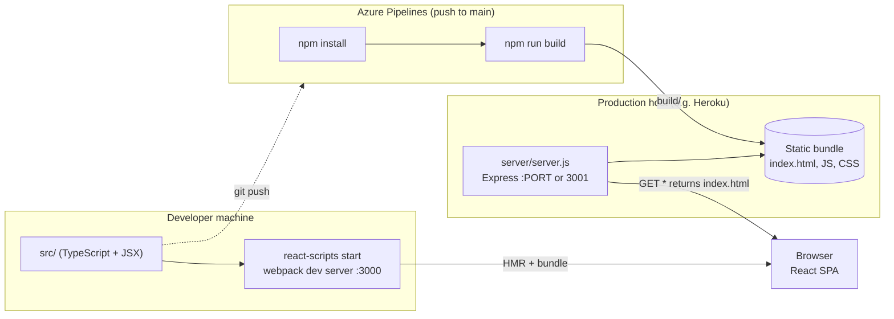

The Express server serves static files and returns `index.html` for every other path, so React Router can handle deep links on the client. The server is currently pointed at `public/` rather than `build/`; see [Design notes](#design-notes-and-technical-debt).

## Application bootstrap and layout

`src/index.tsx` loads global CSS (Bootstrap, then `index.css`), declares the whole route table and renders it into `#root`. `App` is the layout route: it provides the theme and the date adapter, draws the app bar and drawer, and renders the active page through `<Outlet/>`.

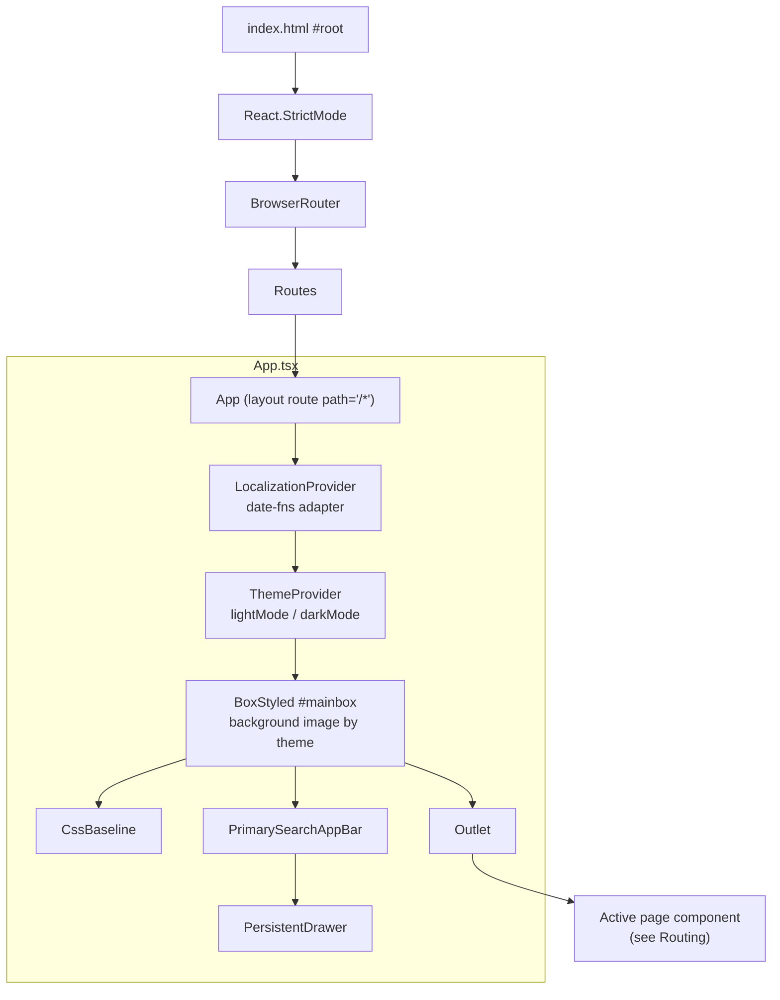

## Routing

All routes are children of the `App` layout route, so every page shares the app bar and theme.

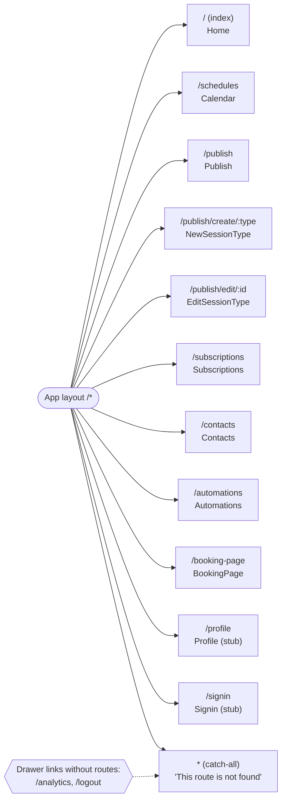

| Path | Component | File | Params |
|---|---|---|---|
| `/` | `Home` | `src/routes/Home.tsx` | |
| `/schedules` | `Calendar` | `src/routes/Calendar.tsx` | |
| `/publish` | `Publish` | `src/routes/publish/Publish.tsx` | |
| `/publish/create/:type` | `NewSessionType` | `src/routes/publish/NewSessionType.tsx` | `type`: `one-on-one`, `group`, `collective` or `round-robin` |
| `/publish/edit/:id` | `EditSessionType` | `src/routes/publish/EditSessionType.tsx` | `id`: session type id |
| `/subscriptions` | `Subscriptions` | `src/routes/Subscriptions.tsx` | |
| `/contacts` | `Contacts` | `src/routes/Contacts.tsx` | |
| `/automations` | `Automations` | `src/routes/Automations.tsx` | |
| `/booking-page` | `BookingPage` | `src/routes/BookingPage.tsx` | |
| `/profile` | `Profile` | `src/routes/Profile.tsx` | |
| `/signin` | `Signin` | `src/routes/Signin.tsx` | |
| `*` | inline element | `src/index.tsx` | |

Route params are read with `useParams()` in the thin route wrappers (`NewSessionType`, `EditSessionType`) and passed down as props to the card components that render the forms.

## Component catalogue

Components fall into three layers:

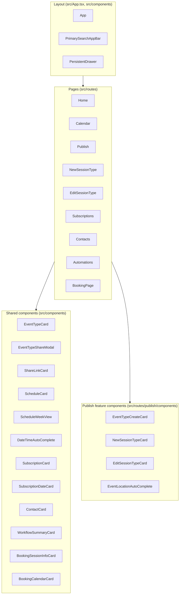

| Component | Responsibility |
|---|---|
| `PrimarySearchAppBar` | Fixed top bar: menu button, title, search box, dark-mode switch, mail, notification and account icons, and a mobile overflow menu. Owns the drawer's open state. |
| `PersistentDrawer` | Left navigation drawer. Builds links from a label list (`'Contacts'` becomes `/contacts`) and maps labels to icons. |
| `EventTypeCard` | One published session type: duration, kind, name. Favourite, edit (links to `/publish/edit/1`) and share actions; expandable. |
| `EventTypeShareModal` | Dialog with tabs **Share a link**, **Add to email** and **Add to website**. |
| `ShareLinkCard` | Booking link with copy button, expire-after-first-booking switch and preview link. |
| `ScheduleCard` | Named availability schedule; expands to show `ScheduleWeekView`. |
| `ScheduleWeekView` | Per-day rows with a checkbox and start/end pickers. Uses `react-device-detect` to show native `<input type="time">` on iOS. |
| `DateTimeAutoComplete` | MUI `Autocomplete` over a fixed list of times. |
| `SubscriptionDateCard` | Date header that groups bookings. |
| `SubscriptionCard` | One booking: time range, session name, kind, invitee email, location and time zone. |
| `ContactCard` | One contact: name and email. |
| `WorkflowSummaryCard` | One automation workflow with icon and name. |
| `BookingSessionInfoCard` | Invitee view of session details (title, host, duration, location). |
| `BookingCalendarCard` | `StaticDatePicker` for picking a booking date. |
| `EventTypeCreateCard` | One session kind on `/publish`, with a **Create** button linking to `create/:type`. |
| `NewSessionTypeCard` | Short create form; icon chosen by `type`. **Next** goes to the editor. |
| `EditSessionTypeCard` | Full editor as an accordion of settings sections, with Back, Cancel and Save. |
| `EventLocationAutoComplete` | Free-solo location picker: suggests Google Meet or Phone Call, or lets you add a custom value. |
| `ExampleSelect`, `ScheduleCalendarView` | Unused: an experiment and an empty stub. |

## Page compositions

### Home and sharing

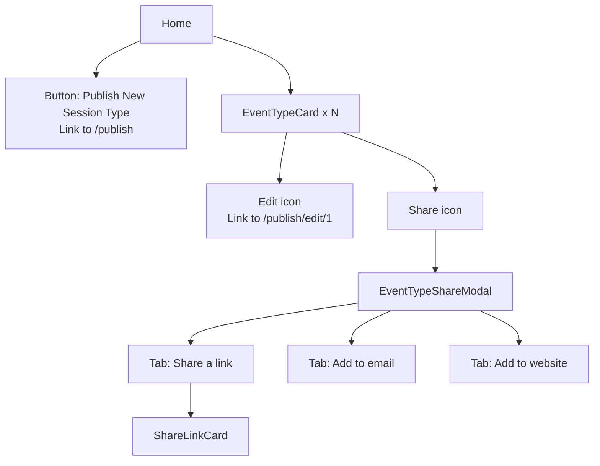

### Publish flow

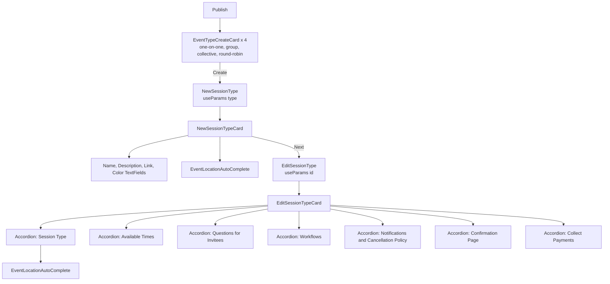

### Schedules

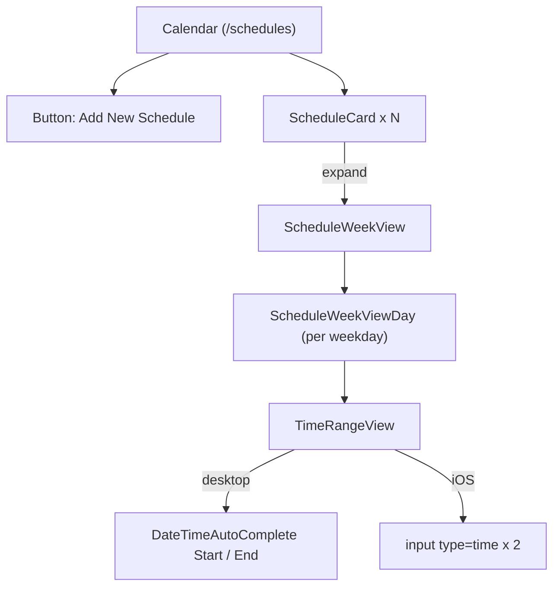

### Bookings, contacts, automations and the booking page

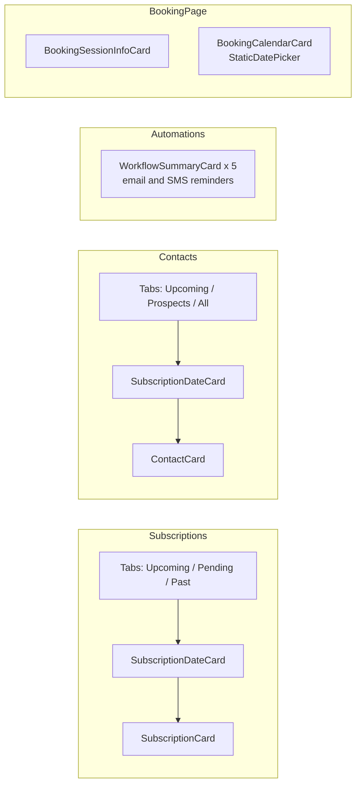

`Subscriptions` and `Contacts` each define their own local `TabPanel` and `a11yProps` helpers (the MUI tabs example pattern).

## User flows

### Host publishes a session type

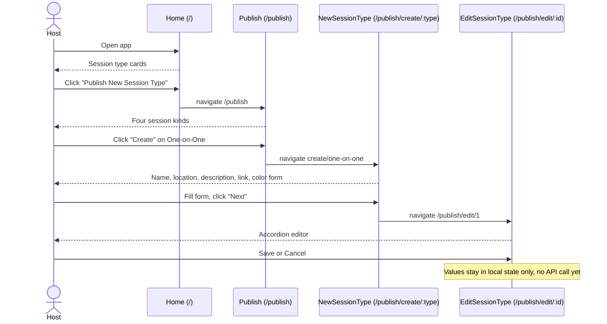

### Host shares a booking link and an invitee books

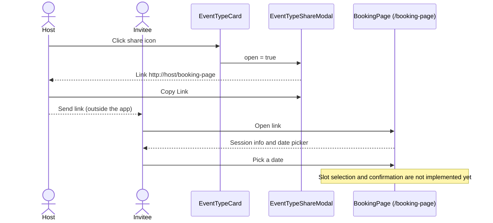

## State management

There is no global store (Redux, Context or similar) and no server state. All state is `React.useState` in the component that uses it.

| Owner | State | Purpose |
|---|---|---|
| `App` | `darkModeChecked` | Position of the theme switch. The selected theme object is held in a module-level variable `theme`. |
| `App` | `drawerOpen` | Passed to the app bar but not used to drive the drawer. |
| `PrimarySearchAppBar` | `drawerOpen`, `anchorEl`, `mobileMoreAnchorEl` | Drawer visibility and menu anchors |
| Card components | `expanded` | Expand/collapse of the card body |
| `EventTypeCard` | `shareModalOpen` | Share dialog visibility |
| `EventTypeShareModal` | `selectedTab` | Active share tab |
| `ShareLinkCard` | `copyButtonText` | "Copy Link" / "Link Copied! ✓" feedback (resets after 1.5 s) |
| `Subscriptions`, `Contacts` | `value` | Active tab |
| `NewSessionTypeCard`, `EditSessionTypeCard` | `formValues` | Form inputs (not saved) |
| `EditSessionTypeCard` | `expanded` | Open accordion panel |
| `BookingCalendarCard`, `ScheduleWeekViewDay`, autocompletes | `value` | Selected date or time |

### Theme switching

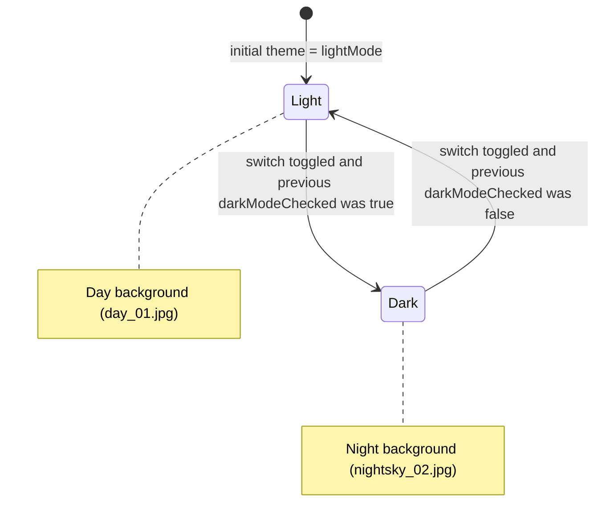

`handleDarkModeChange` sets `darkModeChecked` and then branches on the value from **before** the click, so the theme lags one toggle behind the switch. Holding the theme in a module variable instead of state also means the change only shows up because the `setDarkModeChecked` call triggers a re-render. The fix is to derive the theme from state: `const theme = darkModeChecked ? darkMode : lightMode`.

## Component props

Props are declared as `I<Component>Props` interfaces and components are typed as `React.FC<Props>`.

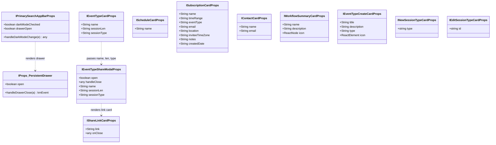

`ISubscriptionCardProps.email`, `notes` and `createdDate` are optional. Several props use the boxed `String` type rather than the primitive `string`; prefer `string` in new code.

## Styling and theming

- **MUI themes** are defined in `App.tsx`: `lightMode` (black primary, white app bar) and `darkMode` (`#ccd9e0` primary, black app bar). Both use `#f50057` as the secondary colour.
- **Background:** `BoxStyled` in `App.tsx` picks `src/images/day_01.jpg` or `nightsky_02.jpg` based on `theme.palette.mode` and fixes it to the viewport.
- **Cards** are styled with MUI `styled()` and `sx`, and use translucent dark backgrounds so the background image shows through. Each card file has its own copy of the `ExpandMore` rotating-chevron helper from the MUI card example.
- **Global CSS:** Bootstrap 5 CSS is imported before `index.css`, so app styles take precedence. `App.css` holds a few leftovers from CRA.
- **Responsive layout** uses the MUI `Grid` breakpoints (`xs`/`sm`/`md`) and `useMediaQuery('(min-width:600px)')` to hide secondary text on small screens.
- **Dates:** `LocalizationProvider` with the `date-fns` adapter at the root, so every MUI Lab picker shares it.

## Build and delivery pipeline

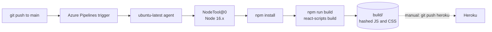

The pipeline doesn't run `npm test`, publish build artifacts or deploy. Heroku deployment is manual (see [getting-started](getting-started.md#deploying-to-heroku)).

## Design notes and technical debt

| Area | Observation | Suggested direction |
|---|---|---|
| Data | All entities are hard-coded JSX props in route files. | Define domain types (`SessionType`, `Schedule`, `Booking`, `Contact`, `Workflow`) in `src/types/` and load them through a data layer. |
| Server | `server/server.js` serves `public/` instead of `build/`. | Point it at `build/` and add a `start:prod` script or Procfile. |
| Routing | Edit links and **Next** are hard-coded to `/publish/edit/1`. Drawer links `/analytics` and `/logout` have no routes. | Use real ids; add routes or remove the links. |
| Forms | Every `TextField` in the session type forms uses `name="name"`. | Give each field a unique `name` that matches a key in `defaultValues`. |
| Theme | The switch handler reads stale state, and the theme lives in a module variable. | Derive the theme from state with `useMemo`. |
| Schedules | `ScheduleWeekView` lists `Sun, Mon, Wed, Thu, Fri, Sat` (no Tuesday). Non-iOS mobile renders an empty `
`. | Fix the day list; use the MUI `TimePicker` on all platforms. |
| Duplication | `ExpandMore`, `TabPanel` and `a11yProps` are copied across files. | Extract them to `src/components/common/`. |
| Dependencies | `react-dnd`, `jquery`, `popper.js` and the Bootstrap JS bundle are unused. MUI and Emotion are pinned to `latest`. | Remove the unused packages; pin exact versions. |
| Tests | Only the stale CRA template test exists, and it fails. | Add React Testing Library tests per route, rendered inside `MemoryRouter`. |

## Extending the app

### Adding a backend

The intended shape once an API exists:

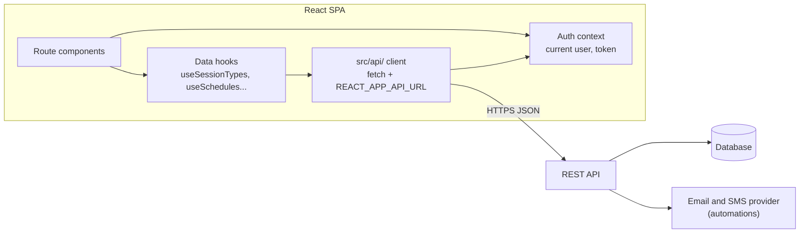

- Keep route components thin: fetch data through hooks and pass plain props to the existing cards, which are already presentational.
- Put cross-cutting state (current user, theme) in React Context providers alongside `ThemeProvider` in `App.tsx`.
- Express in `server/` can also proxy `/api` while it serves the SPA.

### Adding a page

See [getting-started: Adding a new page](getting-started.md#adding-a-new-page). In short: create the component in `src/routes/`, register it under the `App` route in `src/index.tsx`, and add a label and icon in `PersistentDrawer`.

### Conventions

- One default-exported component per file, named after the file.
- `I<Name>Props` interfaces with `React.FC<Props>`.
- Feature-specific components live in a `components/` folder next to the feature's routes (`src/routes/publish/components/`). Components used across features go in `src/components/`.
- Pages start with `<Box sx={{ paddingTop: 12 }}>` to clear the fixed app bar.
